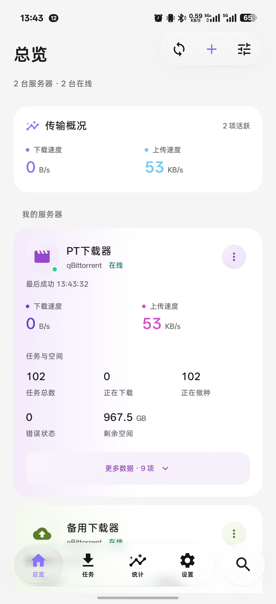
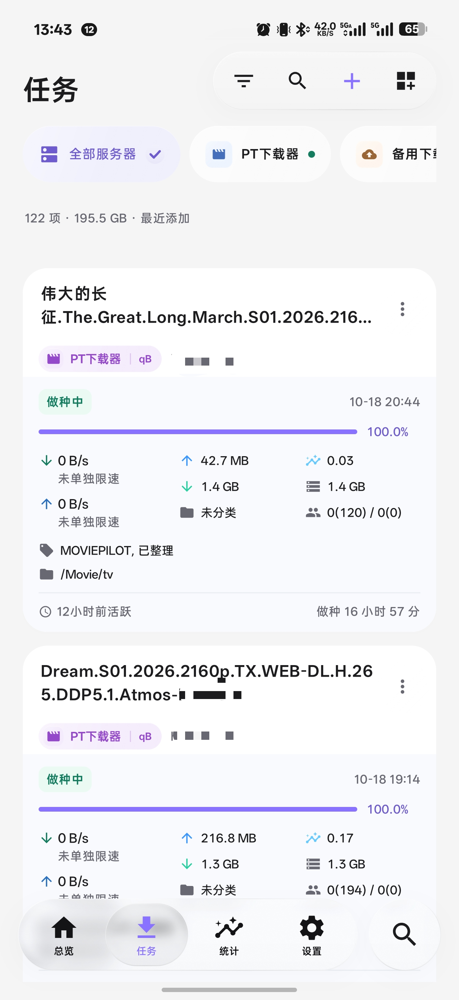
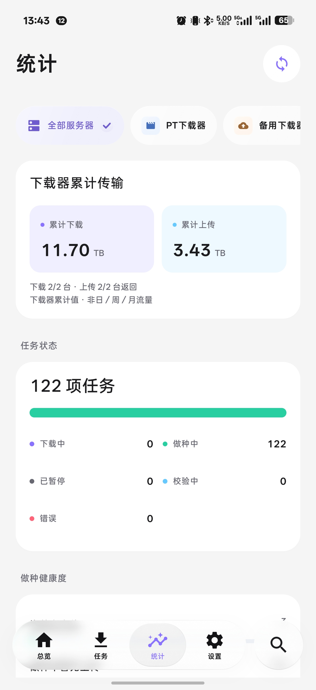
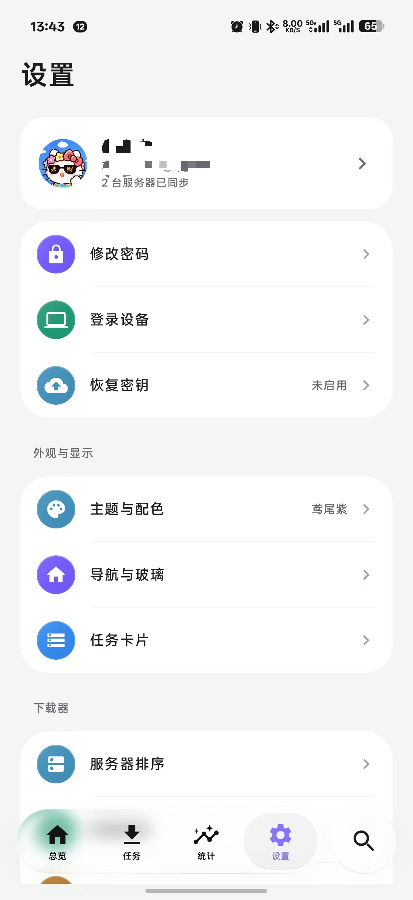
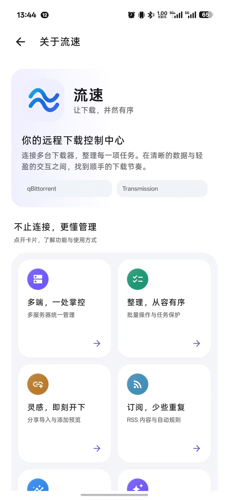

# 🌊 流速 · Liusu

**免费的 Android 远程下载管理工具，让多台下载器在手机里井井有条。**

连接你自己的 **qBittorrent / Transmission**，集中查看下载与做种任务，随时添加下载、调整任务和管理服务器。

**[⬇️ 下载最新安装包](https://github.com/zeyu8023/liusu/releases/latest)** · **[💬 反馈问题](https://github.com/zeyu8023/liusu/issues)**

---

## 流速是什么？

流速是一款面向 NAS、VPS 和自建下载器用户的 Android 客户端。无需来回打开多个下载器的网页，就能在一个 App 中管理不同服务器的任务。

它需要连接你已有的下载器，不提供下载资源，也不代替下载器本身运行下载任务。

## 📱 界面预览

总览、任务管理、统计、设置与关于页面实机截图，点击图片可查看大图。

<table>
  <tr><th>总览</th><th>任务管理</th><th>统计</th></tr>
  <tr>
    <td></td>
    <td></td>
    <td></td>
  </tr>
  <tr><th>设置</th><th>关于流速</th><th></th></tr>
  <tr>
    <td></td>
    <td></td>
    <td></td>
  </tr>
</table>

## 🧰 主要功能

| 功能 | 说明 |
| --- | --- |
| 多服务器管理 | 连接多台 qBittorrent / Transmission，查看状态、速度、任务数量、累计传输量等数据 |
| 添加下载 | 支持磁力链接、种子 URL、本地种子文件，以及 Android 系统分享接收 |
| 任务管理 | 搜索、筛选、排序，暂停、继续、校验、重新公告和删除；支持多选批量操作 |
| 任务详情 | 查看文件、Tracker 和连接用户，管理文件下载优先级 |
| 整理与限速 | 管理任务分类、标签、保存路径与限速；具体能力取决于下载器及版本 |
| RSS 工作台 | qBittorrent RSS 订阅、条目阅读、关键词匹配和自动下载规则 |
| 统计查看 | 展示下载器已有累计传输数据、任务状态、分享率和站点分布 |
| 配置与备份 | 支持账号配置同步、加密备份与恢复、连接诊断 |
| 日常便利 | 内外网双地址、常用组合筛选、任务保护和桌面小组件 |

> RSS 管理面向 qBittorrent。Transmission 与 qBittorrent 的接口能力不同，部分功能不会完全一致。
>
> 统计以下载器返回的数据为准，不把累计值编造成日／周／月历史流量。

## ✨ 体验亮点

- **玻璃风格界面**：悬浮导航与操作组、二级玻璃菜单，以及边缘折射效果。
- **浅色 / 深色外观**：支持跟随系统和多种主题配色。
- **按习惯展示任务**：紧凑、标准、详细布局，可调整卡片字段。
- **多服务器清晰区分**：服务器头像、身份色与任务来源标签。
- **适合日常操作**：下拉刷新、长按多选、导航双击回顶、缓存展示。

玻璃表现随 Android 版本、设备和透明度设置有所不同。

## 👥 适合谁使用？

- 家里有 NAS，想用手机查看和管理下载任务的朋友。
- 在 VPS 或其他设备上运行下载器，需要远程管理的用户。
- 有多台下载器，希望集中查看下载、上传和做种情况的用户。
- 使用 qBittorrent RSS，希望在手机上维护订阅和规则的用户。

## 📦 下载与开始使用

1. 打开 **[Releases](https://github.com/zeyu8023/liusu/releases/latest)**，下载 `.apk` 安装包。
2. 在 Android 手机上安装，完成流速账号注册或登录。
3. 添加自己的 qBittorrent 或 Transmission 服务器，填写地址及下载器账号。
4. 确认手机可以访问下载器的 Web UI / RPC 接口，即可开始使用。

**系统要求：Android 8.0 及以上。**

更新时使用同一来源的新版安装包覆盖安装即可。重要配置建议先备份；请只连接你有权管理的下载器。

## 🆓 免费与开发说明

**流速目前免费使用。**

也坦诚说明：**流速是借助 AI 辅助开发、持续迭代的项目。** AI 参与代码与界面开发，版本会继续根据实际使用反馈改进。现阶段仍可能存在 Bug、兼容性问题和需要打磨的细节。

本仓库用于发布 APK、软件介绍和接收反馈，当前不公开项目源代码。

## 🛠️ 问题反馈

欢迎通过 **[GitHub Issues](https://github.com/zeyu8023/liusu/issues)** 提交 Bug 和建议。尽量提供：

- App 版本、手机型号、Android 版本；
- 下载器类型与版本；
- 复现步骤、预期表现和截图。

提交反馈前，请遮盖密码、令牌、私有下载链接和服务器敏感信息。

---

感谢每一位愿意体验、反馈并帮助流速变得更好用的朋友。🌊
